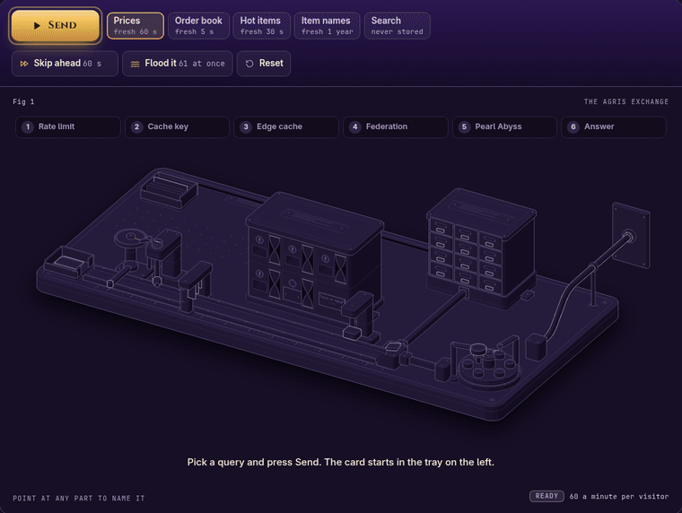

<p align="center">
  <a href="https://agris-docs.hebilicious.workers.dev"></a>
</p>

<h1 align="center">⚖️ Agris</h1>

<p align="center">
  <strong>The Black Desert Online Central Market as a free, open-source, federated GraphQL API you run yourself.</strong>
</p>

<p align="center">
  <a href="LICENSE"></a>
  
  
  
  
  
</p>

<p align="center">
  <a href="https://agris-docs.hebilicious.workers.dev">🌙 Website</a> ·
  <a href="https://agris-demo.hebilicious.workers.dev/graphql">🧪 Demo API</a> ·
  <a href="docs/deploy.md">🚀 Deploy guide</a> ·
  <a href="docs/api.md">📖 API reference</a> ·
  <a href="tools/schema/artifacts/client-schema.graphql">🧬 Schema</a>
</p>

Prices, stock, order books, price history, hot items and the registration queue for every market region, joined with item names in 12 languages and a name search, in one typed GraphQL query. It runs on **your own Cloudflare account**, with no API key and nobody else's traffic.

## ✨ Why Agris

- 🧾 **A clear GraphQL schema.** Pearl Abyss's trade servers answer with undocumented positional rows, some Huffman-compressed. Agris gives you named, typed fields.
- 🏷️ **Item names, joined in.** The market only knows numeric IDs. Agris adds names and grades in 12 languages, from the item catalog shipped in this repository.
- 🔎 **Name search.** `searchItems(query: "memory frag")` finds items by part of their name, ignoring case and accents, with prices in the same query.
- 📦 **One request, many items.** Ask for many items, regions and price histories at once; Agris batches the upstream calls.
- ⚡ **Edge caching.** Each field has its own freshness window, from seconds for order books to much longer for item names, so repeated queries come straight from Cloudflare's cache.
- 🤝 **Kind to Pearl Abyss.** Identical requests in flight share one upstream call, and a cap on concurrent calls queues the rest.
- 🏠 **Yours.** Your account, your limits, your cache, your hostname.

## 🆓 100% free and open source

Agris is MIT licensed: the API, the Workers, the tests, the website and the artwork. Bundled third-party pieces keep their own licenses. There is no paid tier, no open core and no account to create.

- **No API key.** Your gateway answers to you.
- **No tracking.** The website has no analytics and no cookies, and your gateway logs only to your own Cloudflare account.
- **Run it yourself.** Five commands deploy your own copy, on `workers.dev` or any hostname you own.
- **Pull requests welcome.** Read [CONTRIBUTING.md](CONTRIBUTING.md); it fits on one screen.

## 🧭 30-second example

Open `/graphql` on any Agris gateway in a browser for GraphiQL, or send a query from anywhere:

```graphql
query {
  searchItems(query: "memory frag", locale: EN, first: 1) {
    items {
      id
      name
      marketSummary(region: EU) {
        basePrice
        currentStock
      }
    }
  }
}
```

```json
{
  "data": {
    "searchItems": {
      "items": [
        { "id": "44195", "name": "Memory Fragment", "marketSummary": { "basePrice": 2450000, "currentStock": 70598 } }
      ]
    }
  }
}
```

(The demo's answer on 12 October 2026; prices move.) Same thing with curl:

```sh
curl https://<your-host>/graphql -H 'content-type: application/json' \
  -d '{"query":"{ market(region: EU) { items(ids: [\"44195\", \"16001\"]) { item { name } basePrice } } }"}'
```

## 🎰 See it work

<p align="center">
  <a href="https://agris-docs.hebilicious.workers.dev/#machine"></a>
</p>

The website draws Agris as a counting-house machine and lets you drive it: send a query, watch a MISS travel out to Pearl Abyss and back, send it again for a HIT, skip ahead to see it go STALE, or flood the turnstile for a 429.

## 🧱 The stack

Agris is a real federated graph: two subgraphs composed into one supergraph and executed by Hive Gateway inside a Cloudflare Worker.

| Layer           | Built with                                                                                                                                                                                                            | Why                                                                                           |
| --------------- | --------------------------------------------------------------------------------------------------------------------------------------------------------------------------------------------------------------------- | --------------------------------------------------------------------------------------------- |
| 🕸️ The graph    | **[Apollo Federation v2](https://github.com/apollographql/federation)** entities                                                                                                                                      | The catalog owns `Item`; the market extends it with prices. Clients see one schema.           |
|                 | **[Hive Gateway](https://github.com/graphql-hive/gateway)** (`@graphql-hive/gateway-runtime`)                                                                                                                         | The Guild's open-source federation gateway, embedded as a runtime inside the gateway Worker.  |
|                 | **[GraphQL Mesh](https://github.com/ardatan/graphql-mesh) Compose** (`@graphql-mesh/compose-cli`)                                                                                                                     | Composes the supergraph at build time, so the gateway starts with its plan ready.             |
|                 | **[Pothos](https://github.com/hayes/pothos)** with its federation, dataloader and directives plugins                                                                                                                  | Type-safe, code-first subgraph schemas.                                                       |
|                 | **[GraphQL Yoga](https://github.com/graphql-hive/graphql-yoga)**                                                                                                                                                      | Serves each subgraph, and GraphiQL in the browser.                                            |
|                 | **[Envelop](https://github.com/graphql-hive/graphql-yoga/tree/main/packages/envelop)** plugins                                                                                                                        | Add your own to the gateway in one list: `apps/gateway/src/plugins.ts`.                       |
| ☁️ The edge     | **[Cloudflare Workers](https://github.com/cloudflare/workerd)** (the workerd runtime)                                                                                                                                 | A public gateway, its cache Worker and two private subgraph Workers, in your account.         |
|                 | **Service Bindings**                                                                                                                                                                                                  | Worker-to-Worker calls; only the gateway has a public URL.                                    |
|                 | **Durable Objects**                                                                                                                                                                                                   | One coordinator per Pearl Abyss host, placed near it, merges identical calls and caps them.   |
|                 | **Workers rate limiting** and the **Workers cache**                                                                                                                                                                   | Floods are turned away first; a cache-enabled Worker sits in front of execution.              |
| 🧑‍💻 The code     | **[TypeScript](https://github.com/microsoft/TypeScript)**, strict                                                                                                                                                     | End to end, with upstream data treated as `unknown` until validated.                          |
|                 | **[XState](https://github.com/statelyai/xstate)**, **[Effect](https://github.com/Effect-TS/effect)**, **[Effect Schema](https://github.com/Effect-TS/effect/blob/main/packages/effect/src/Schema.ts)**                | State machines for the connection pool and transport; typed effects; validation at the edges. |
| 🛠️ The workshop | **[Alchemy](https://github.com/alchemy-run/alchemy)**                                                                                                                                                                 | The deploy definition: the demo, the docs site and your copy as stages of one Effect stack.   |
|                 | **[moon](https://github.com/moonrepo/moon)**, **[proto](https://github.com/moonrepo/proto)**, **[pnpm](https://github.com/pnpm/pnpm)**                                                                                | Cached tasks, pinned toolchains, one workspace catalog.                                       |
|                 | **[oxlint and oxfmt](https://github.com/oxc-project/oxc)**                                                                                                                                                            | Linting and formatting in milliseconds.                                                       |
|                 | **[Vitest](https://github.com/vitest-dev/vitest)** with the [Cloudflare Workers pool](https://github.com/cloudflare/workers-sdk/tree/main/packages/vitest-plugin), **[Gherkin](https://github.com/cucumber/gherkin)** | Every promise is a plain-English scenario, run headless, in-process and in real Workers.      |
|                 | **[Astro](https://github.com/withastro/astro)**                                                                                                                                                                       | The static website and `/llms.txt`.                                                           |
|                 | **[anatomy](https://github.com/wheresryan22/anatomy)**                                                                                                                                                                | The kit the website's Fig 1, the counting-house machine, is drawn with.                       |

## 🔀 How a query flows

```text
client ──HTTPS──▶ agris (gateway Worker: validate, rate limit, Hive Gateway)
                    ├─ Service Binding ─▶ agris-cache     edge cache in front of execution
                    ├─ Service Binding ─▶ agris-catalog   item names in 12 languages + search, in memory
                    └─ Service Binding ─▶ agris-market ──▶ Pearl Abyss Central Market (12 regions)
                                           └─ one Durable Object per upstream host, placed near it, coordinates calls
```

1. The gateway checks the query against the schema and the limits, and counts it against any rate limit you set.
2. The query and its variables are printed in one canonical form and hashed into a cache key.
3. Cacheable queries run behind the cache Worker, so a HIT never reaches a subgraph.
4. On a miss, Hive Gateway plans the query across both subgraphs and joins their answers on the `Item` entity.
5. The catalog answers from memory; the market asks Pearl Abyss through its coordinator.

Only the gateway is public. More in [docs/architecture.md](docs/architecture.md).

## 🚀 Deploy your own

You need a Cloudflare account, plus `git` and `curl`. The default settings deploy on the Workers Free plan; a paid plan lets you raise `SUBREQUEST_LIMIT`.

```sh
curl -fsSLO https://github.com/moonrepo/proto/releases/download/v0.63.1/proto_cli-installer.sh   # proto 0.63.1, as .prototools pins
echo "e33cc6e6e1834ac3d769e311415b4a12013ae33fe2b27cdcf34340a62d97c2b6  proto_cli-installer.sh" | sha256sum -c
PROTO_HOME="$HOME/.proto" PROTO_CLI_NO_MODIFY_PATH=1 sh proto_cli-installer.sh && ~/.proto/bin/proto setup   # open a new shell after
git clone https://github.com/Hebilicious/agris.git && cd agris
proto install && pnpm install
export CLOUDFLARE_ACCOUNT_ID=... CLOUDFLARE_API_TOKEN=...   # an "Edit Cloudflare Workers" token
moon run agris:deploy                                       # agris, agris-cache, agris-market, agris-catalog
curl https://agris.<your-subdomain>.workers.dev/health           # or your own hostname
```

Agris deploys with [Alchemy](https://alchemy.run): `infra/alchemy.run.ts` is the whole deployment, and nothing about your account is written to the repository. The gateway starts on `workers.dev` because that needs no setup. Any hostname works: set `AGRIS_DOMAIN` to a domain on any zone in your account. See [docs/deploy.md](docs/deploy.md#hostnames).

The [shared demo](https://agris-demo.hebilicious.workers.dev/graphql) is small, tightly rate limited and may go away at any time. Use it to look around, not to build on.

## ⚙️ Configuration

Every setting is an environment variable of the deploy command, one variable per value, and every limit can be turned off. Unset keeps the default, so a deploy with nothing set runs the defaults below:

```sh
CACHE_MINIMUM_SECONDS=300 CLIENT_RATE_LIMIT_REQUESTS=60 moon run agris:deploy
```

A misspelt setting or a value Agris cannot use stops the deploy before anything is uploaded. Set them again on every deploy. The demo column is the maintainer's shared demo. [docs/deploy.md](docs/deploy.md#configuration) explains each one.

**Cache.** Each field has a fresh window and a stale-while-revalidate window; an answer takes the shortest of each among the fields it selects. Every value is whole seconds, and `0` turns it off.

| Variable                                                         | Default    | Demo  | Turn off |
| ---------------------------------------------------------------- | ---------- | ----- | -------- |
| `CACHE_ENABLED`                                                  | `true`     |       | `false`  |
| `CACHE_MINIMUM_SECONDS` (a floor for every storable answer)      | `0`        | `600` | `0`      |
| `CACHE_STALE_IF_ERROR_SECONDS`                                   | `86400`    |       | `0`      |
| `CACHE_NEVER_STORED` (comma-separated `Type.field`)              | empty      |       | empty    |
| `CACHE_MARKET_ITEMS_MAX_AGE_SECONDS`                             | `60`       |       | `0`      |
| `CACHE_MARKET_ITEMS_STALE_WHILE_REVALIDATE_SECONDS`              | `70`       |       | `0`      |
| `CACHE_ITEM_MARKET_SUMMARY_MAX_AGE_SECONDS`                      | `60`       |       | `0`      |
| `CACHE_ITEM_MARKET_SUMMARY_STALE_WHILE_REVALIDATE_SECONDS`       | `70`       |       | `0`      |
| `CACHE_MARKET_ITEM_LISTINGS_MAX_AGE_SECONDS`                     | `60`       |       | `0`      |
| `CACHE_MARKET_ITEM_LISTINGS_STALE_WHILE_REVALIDATE_SECONDS`      | `70`       |       | `0`      |
| `CACHE_MARKET_ITEM_ORDER_BOOK_MAX_AGE_SECONDS`                   | `5`        |       | `0`      |
| `CACHE_MARKET_ITEM_ORDER_BOOK_STALE_WHILE_REVALIDATE_SECONDS`    | `5`        |       | `0`      |
| `CACHE_MARKET_REGISTRATIONS_MAX_AGE_SECONDS`                     | `5`        |       | `0`      |
| `CACHE_MARKET_REGISTRATIONS_STALE_WHILE_REVALIDATE_SECONDS`      | `5`        |       | `0`      |
| `CACHE_MARKET_CATALOG_MAX_AGE_SECONDS`                           | `30`       |       | `0`      |
| `CACHE_MARKET_CATALOG_STALE_WHILE_REVALIDATE_SECONDS`            | `30`       |       | `0`      |
| `CACHE_MARKET_HOT_ITEMS_MAX_AGE_SECONDS`                         | `30`       |       | `0`      |
| `CACHE_MARKET_HOT_ITEMS_STALE_WHILE_REVALIDATE_SECONDS`          | `30`       |       | `0`      |
| `CACHE_MARKET_ITEM_PRICE_HISTORY_MAX_AGE_SECONDS`                | `3600`     |       | `0`      |
| `CACHE_MARKET_ITEM_PRICE_HISTORY_STALE_WHILE_REVALIDATE_SECONDS` | `3600`     |       | `0`      |
| `CACHE_QUERY_ITEM_MAX_AGE_SECONDS`                               | `31536000` |       | `0`      |
| `CACHE_QUERY_ITEM_STALE_WHILE_REVALIDATE_SECONDS`                | `86400`    |       | `0`      |
| `CACHE_QUERY_ITEMS_MAX_AGE_SECONDS`                              | `31536000` |       | `0`      |
| `CACHE_QUERY_ITEMS_STALE_WHILE_REVALIDATE_SECONDS`               | `86400`    |       | `0`      |
| `CACHE_QUERY_SEARCH_ITEMS_MAX_AGE_SECONDS`                       | `31536000` |       | `0`      |
| `CACHE_QUERY_SEARCH_ITEMS_STALE_WHILE_REVALIDATE_SECONDS`        | `86400`    |       | `0`      |

**Rate limits.** Workers rate-limit bindings on every request to the gateway, `/health` and preflights included, per client (an IPv6 address by its /64) and for the whole deployment, counted per Cloudflare location with no round trip. The exact market limit is a Durable Object token bucket per client, asked only when a query is about to read the Central Market: a cache hit or a catalog-only query never reaches it. `0` requests turns each one off. A self-hosted gateway limits no client by default; the Pearl Abyss limits below protect the upstream either way. See [docs/deploy.md](docs/deploy.md#rate-limits).

| Variable                             | Default | Demo    | Turn off |
| ------------------------------------ | ------- | ------- | -------- |
| `CLIENT_RATE_LIMIT_REQUESTS`         | `0`     | `10`    | `0`      |
| `CLIENT_RATE_LIMIT_PERIOD_SECONDS`   | `60`    | `60`    |          |
| `CLIENT_RATE_LIMIT_NAMESPACE_ID`     | `42010` | `42021` |          |
| `GLOBAL_RATE_LIMIT_REQUESTS`         | `0`     | `120`   | `0`      |
| `GLOBAL_RATE_LIMIT_PERIOD_SECONDS`   | `60`    | `60`    |          |
| `GLOBAL_RATE_LIMIT_NAMESPACE_ID`     | `42011` | `42022` |          |
| `MARKET_CLIENT_LIMIT_REQUESTS`       | `0`     | `10`    | `0`      |
| `MARKET_CLIENT_LIMIT_PERIOD_SECONDS` | `60`    | `60`    |          |

**Upstream (Pearl Abyss).** One coordinator per Pearl Abyss host, placed next to it, sends each distinct call once. `PA_MAX_CONCURRENT_REQUESTS` applies to each host; the `PA_RATE_LIMIT_*` rate is one allowance for the whole deployment, shared by every host.

| Variable                       | Default | Demo    | Turn off |
| ------------------------------ | ------- | ------- | -------- |
| `PA_MAX_CONCURRENT_REQUESTS`   | `6`     | `2`     | `0`      |
| `PA_RATE_LIMIT_REQUESTS`       | `100`   | `20`    | `0`      |
| `PA_RATE_LIMIT_PERIOD_SECONDS` | `10`    | `60`    |          |
| `PA_RATE_LIMIT_NAMESPACE_ID`   | `42003` | `42020` |          |

**Subrequests.** The gateway, cache and market Workers' `limits.subrequests`, and the budget one query spends within it. A query that needs more gets a `QUERY_BUDGET_EXCEEDED` error.

| Variable           | Default | Demo | Turn off |
| ------------------ | ------- | ---- | -------- |
| `SUBREQUEST_LIMIT` | `50`    | `50` | cannot   |

**Query limits.** How large one public query may be, after fragments are expanded.

| Variable                    | Default | Demo  | Turn off |
| --------------------------- | ------- | ----- | -------- |
| `QUERY_MAX_DEPTH`           | `8`     | `8`   | `0`      |
| `QUERY_MAX_FIELDS`          | `150`   | `150` | `0`      |
| `QUERY_MAX_ALIASES`         | `15`    | `15`  | `0`      |
| `QUERY_MAX_TYPE_EXPANSIONS` | `2`     | `2`   | `0`      |

**GraphiQL and the public surface.**

| Variable                                         | Default   | Demo             | Turn off    |
| ------------------------------------------------ | --------- | ---------------- | ----------- |
| `GRAPHIQL` (GraphiQL at `/graphql` in a browser) | `enabled` | `enabled`        | `disabled`  |
| `DEPLOY_GUIDE_URL` (a link in `429` messages)    | not set   | the deploy guide | leave unset |

**Deployment.**

| Variable                | Default                   | Demo         | Turn off    |
| ----------------------- | ------------------------- | ------------ | ----------- |
| `CLOUDFLARE_ACCOUNT_ID` | required, never committed | maintainer's |             |
| `CLOUDFLARE_API_TOKEN`  | or an Alchemy profile     | maintainer's |             |
| `AGRIS_DOMAIN`          | not set                   | not set      | leave unset |
| `AGRIS_WORKERS_DEV`     | `true`                    | `true`       | `false`     |

Rate-limit namespace IDs are shared by every Worker in an account; if yours already uses these, pick unused numbers.

**Extend it.** `apps/gateway/src/plugins.ts` is a list of [Envelop plugins](https://the-guild.dev/graphql/envelop/plugins), empty by default, that every gateway execution runs. See [docs/deploy.md](docs/deploy.md#extending-the-gateway-with-envelop-plugins).

## 📏 Limits

Queries only, one operation per request, with size, depth, alias and field limits per document and a minimum length for `searchItems`. The numbers are in [docs/api.md](docs/api.md#limits).

## 🧑‍🔧 Develop

```sh
moon run agris:dev     # the four Workers on this machine, gateway on :8790
moon run website:dev   # website on :4321
moon run agris:check   # format, lint, types, tests, artifacts, website build, bundles
```

[CONTRIBUTING.md](CONTRIBUTING.md) and [AGENTS.md](AGENTS.md) cover the conventions and who owns what.

<a id="credits"></a>

## 🙏 Credits

- **[Arsha](https://github.com/guy0090/api.arsha.io)** (api.arsha.io, by guy0090): its open-source Central Market API was the reference for the Pearl Abyss endpoints, request shapes and response fields Agris uses. Thank you.
- **[anatomy](https://github.com/wheresryan22/anatomy)** by Ryan (MIT): the website's Fig 1, the request path drawn as a machine, is built with it, vendored in `website/vendor/anatomy`.

The Agris artwork on this README and the website, and the favicon, are original to this project and MIT licensed.

## ⚠️ Disclaimer

Agris is an unofficial community project, not affiliated with, endorsed by, or sponsored by Pearl Abyss or Arsha. Black Desert and Black Desert Online are trademarks of Pearl Abyss. Use the market data responsibly. Provided as is, under the [MIT license](LICENSE).
